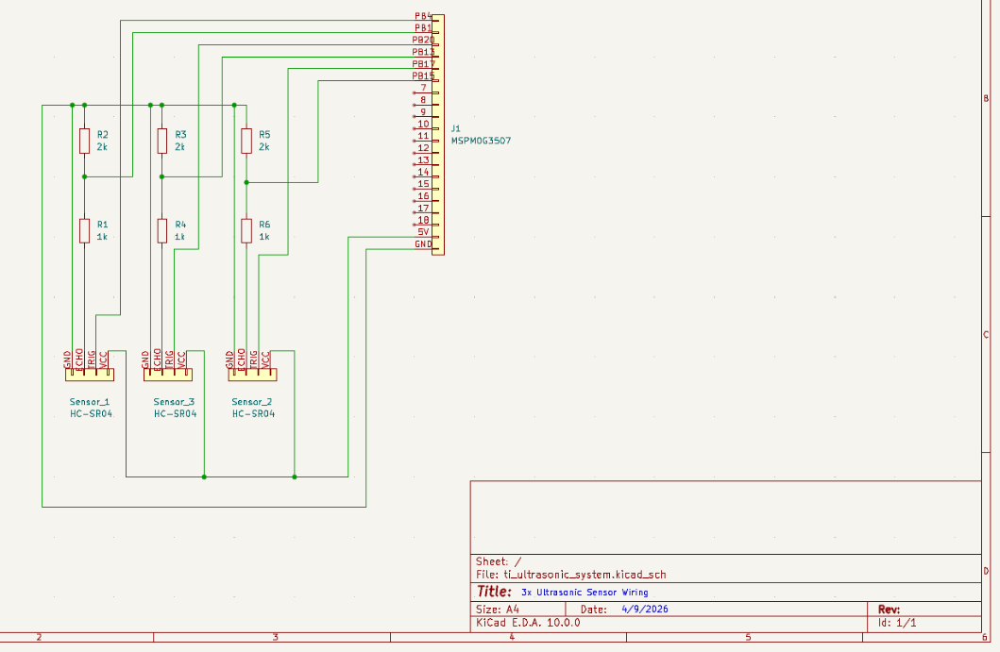
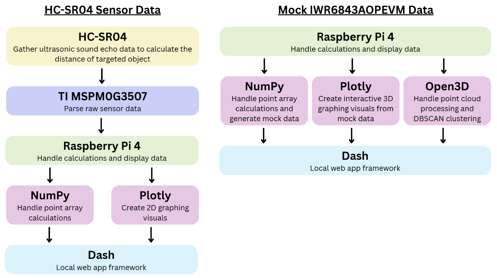
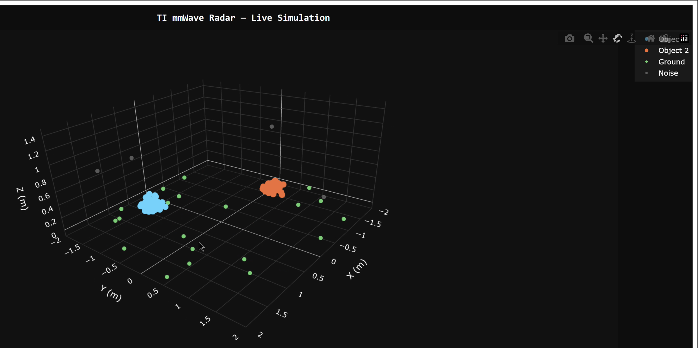
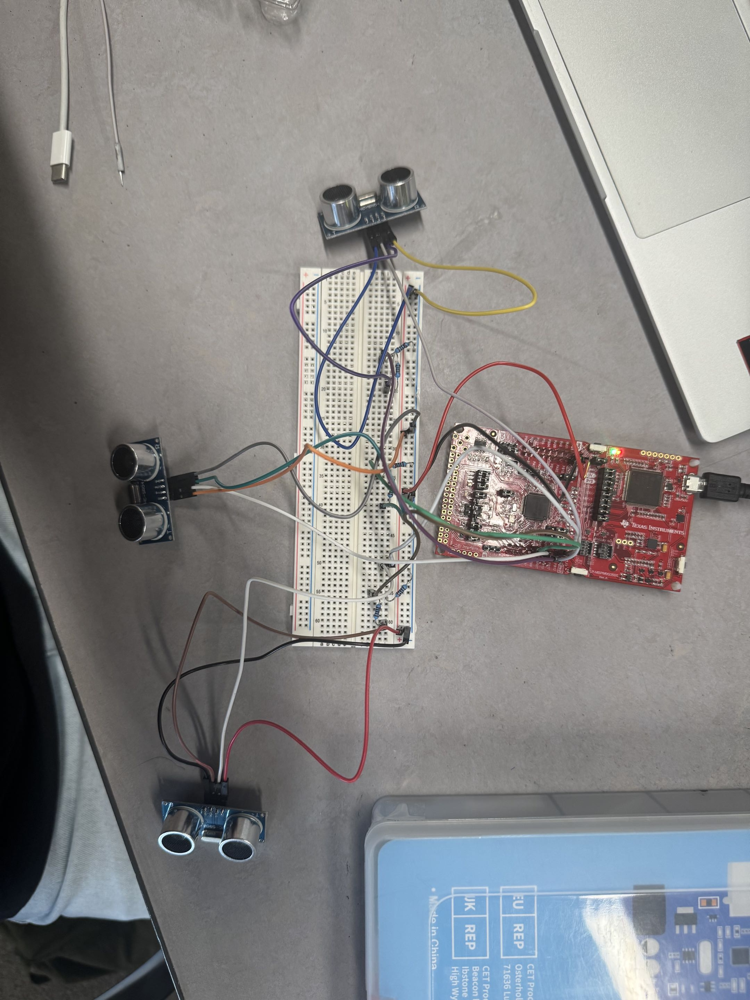

# Project Title

Texas Instruments Raspberry Pi mmWave Radar Sensor

## Team

| Name                 | GitHub                                           | Email                        |
| -------------------- | ------------------------------------------------ | ---------------------------- |
| Paul Brandon Estigoy | [@Brannflakess](https://github.com/Brannflakess) | paulbrandon.estigoy@sjsu.edu |
| Raghav Gautam        | [@RaghavG17](https://github.com/RaghavG17)       | raghav.gautam@sjsu.edu       |
| Colin Oliva          | [@colinoliva](https://github.com/colinoliva)     | colin.oliva@sjsu.edu         |
| Ernest Ma            | [@maernest04](https://github.com/maernest04)     | ernest.ma@sjsu.edu           |

**Advisor:** Dr. Charan Bhaskar

---

## Problem Statement

Achieving reliable and affordable 3D environment mapping remains a significant hurdle for DIY developers, robotics teams, and small businesses. While industrial-grade LiDAR offers high precision, its prohibitive cost limits its accessibility. Conversely, low-cost radar sensors frequently suffer from signal noise and false positives when operated as standalone units, leading to untrustworthy spatial data in consumer applications like surveillance and monitoring. The core technical challenge lies in the inherent limitations of single-sensor deployments; however, by synchronizing multiple sensors in a unified array, it is possible to mitigate noise and achieve high-fidelity 3D mapping that rivals expensive industrial systems at a fraction of the cost.

## Solution

Our solution leverages an array of synchronized Texas Instruments mmWave radar sensors interfaced with a Raspberry Pi to provide high-precision 3D mapping at a consumer-friendly price point. By implementing an edge-based processing pipeline, the system utilizes advanced spatial algorithms—including DBSCAN clustering, trilateration, and voxel downsampling—to aggregate data from multiple vantage points and filter out signal noise. This synchronized multi-sensor approach drastically reduces false positives and provides a robust, real-time 3D visualization, offering a reliable alternative to expensive industrial LiDAR systems.

### Key Features

#### Hardware Implementation

System utilzies a TI MSPM0g3507 Microcontroller to interface three HC-SR04 ultrasonic sensors and to simulate a multi sensor embedded pipeline.

Current setup includes:

- 1x TI MSPM0G3507 LaunchPad
- 3x HC-SR04 Ultrasonic Sensors
- Resistors (1k and 2k for voltage dividers)
- Breadboard + jumper wires

Each sensor is connected to the microcontroller and used GPIO pins for both the TRIG (output signal) & ECHO (input signal)

Since the ECHO pin outputs 5 volts a voltage divider needs to be used to step it down to 3.3v to safely connect to the microcontroller.

(SEE src/hardware/Schematics FOR BREADBOARD AND RESISTOR IMPLEMENTATION)


How the Sensor Operation works:

1. MCU sends a short pulse to the TRIG pin.
2. Sensor emits an ultrasonic signal.
3. When the echo returns, the ECHO pins goes HIGH.
4. The duration of the HIGH signal calculates the distance.

Multi-Sensor Design:

- Each sensor uses unique GPIO pins
- Sensors are triggered one at a time
- Small Delay is added between readings to avoid interference.

Purpose is to simulate an end to end pipe line. Hardware Implementation works on the Sensor, Embedded, and Communication layers.

UART OUTPUT:
After computing the distances, MCU sends formatted data over serial:

S1,dist=13.2
S2,dist=25.7
S3,dist=42.1

This allows real time monitoring for the system.

Current Status
While we wait for the TI mmWave sensors, this system will act as a mock version of validating:

- Multi Sensor coordination
- Embedded Data Processing
- Serial Communication Pipeline
  This ensures a strong foundation for when we integrate with the final sensors.

#### Software Implementation with Mock TI Data

- A separate python script uses mock data to simulate a 3D environment that the TI IWR6843AOPEVM mmWave radar sensors would produce in theory.
- 

---

## Demo

**Mock Data Demo:** https://drive.google.com/file/d/1wVJb_W66xzq6F7lCRgQK-DBDRxVU7pMl/view?usp=sharing

---

## Screenshots

| Feature                            | Screenshot                               |
| ---------------------------------- | ---------------------------------------- |
| Software Mock Data 3D Mapping      |          |
| 3 Ultrasonic Sensor Implementation |  |

---

## Tech Stack

| Category | Technology                                                             |
| -------- | ---------------------------------------------------------------------- |
| Frontend | Dash                                                                   |
| Backend  | C, Python (Open3D, Plotly, NumPy)                                      |
| Database | Local Storage on Raspberry Pi 4                                        |
| Hardware | TI LaunchPad LP-MSPM0G3507, HC-SR04 Ultrasonic Sensors, Raspberry Pi 4 |

---

## Getting Started

### Prerequisites

- Python 3.8+ (3.10 recommended)
- `pip` (or a Python package manager such as `pipx`/`pipenv`)
- Optional: `virtualenv` / `venv` to create an isolated environment
- For the full processing pipeline (`ti_sim.py`): `open3d` and its native dependencies (may require additional build tools)
- For low-resource devices (Raspberry Pi) use `simple_ti_sim.py` which avoids `open3d`

### Installation

```bash
# Clone the repository
git clone https://github.com/SJSU-CMPE-195/group-project-team-goofy-goobers.git
cd [repo]
```

### Install dependencies

1. Change into the prototype software folder:

```bash
cd src/prototype/software
```

2. Install dependencies:

```bash
# Install everything listed in the repo requirements (if present)
pip install --upgrade pip
pip install -r requirements.txt

# Or install the minimal set for the lightweight demo
pip install numpy dash plotly

# If you plan to run the full Open3D pipeline:
pip install open3d
```

### Running Locally

Run the lightweight simulator (recommended for quick checks or Raspberry Pi):

```bash
cd src/prototype/software
python simple_ti_sim.py
```

Run the full processing pipeline (requires `open3d`):

```bash
cd src/prototype/software
python ti_sim.py
```

Both scripts start a Dash app listening on `http://localhost:8050` by default. Open that URL in your browser (or use `http://<device-ip>:8050` from another device on the same network).

## Project Structure

Relevant prototype layout:

- `src/prototype/`
  - `hardware/` — hardware notes, schematics and TI microcontroller examples ([src/prototype/hardware/HARDWARE.md](src/prototype/hardware/HARDWARE.md#L1))
  - `software/` — simulation and visualization scripts
    - `mapping_mock_data.py` — trilateration / ultrasonic mock data and small plotting helper ([src/prototype/software/mapping_mock_data.py](src/prototype/software/mapping_mock_data.py#L1))
    - `simple_ti_sim.py` — lightweight Dash + Plotly 3D mock simulator (recommended)
    - `ti_sim.py` — full Open3D processing pipeline + Dash visualization (heavier dependencies)

- `tests/` — unit tests for the prototype code (for example, [tests/test_mapping_mock_data.py](tests/test_mapping_mock_data.py#L1))

## Use `src/prototype/software` as the working directory when running the prototype demos.

## Contributing

1. Create a feature branch (`git checkout -b feature/amazing-feature`)
2. Commit your changes (`git commit -m 'Add amazing feature'`)
3. Push to the branch (`git push origin feature/amazing-feature`)
4. Open a Pull Request

### Branch Naming

- `feature/` - New features
- `fix/` - Bug fixes
- `docs/` - Documentation updates
- `refactor/` - Code refactoring

### Commit Messages

Use clear, descriptive commit messages:

- `Add user authentication endpoint`
- `Fix database connection timeout issue`
- `Update README with setup instructions`

---

<!-- ## License

This project is licensed under the <FILL IN> License - see the [LICENSE](LICENSE) file for details.

--- -->

_CMPE 195A/B - Senior Design Project | San Jose State University | Spring 2026_
